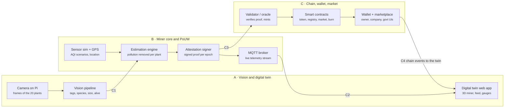

# AIRcoin — Product Requirements Document

Oct 10, 2026 · @omkar

> Markdown conversion of `AIRcoin — Product Requirements Document.pdf`. The PDF is the source of truth; diagrams are redrawn here as Mermaid.

## 1. Overview

AIRcoin pays people for growing pollution-absorbing plants. A low-cost camera "miner" watches up to 20 tagged plants and estimates the pollution they remove. It mints AIRcoin as proof of that useful work. Polluting companies must buy and burn AIRcoin to meet compliance, which creates demand.

**Problem.** Urban air pollution (PM2.5, PM10, NO₂, SO₂, CO, VOCs, CO₂) has no direct, verifiable incentive for citizens to fight it. Carbon credits target large projects and are hard for households to join.

**Product in one line.** A plant-monitoring miner, a token minted from verified plant work, and a marketplace where citizens sell the token and polluters buy and burn it.

**Hackathon goal.** Show a working end-to-end system on stage:

- A physical 20-plant rig with a real camera, Raspberry Pi and GPS.
- A live digital twin: camera feed with detections, a 3D model of the miner's insides, sensor gauges and a minting ticker.
- Live anti-cheat: removing a plant, adding a fake plant or reusing a sticker is caught on screen.
- Real miner software fed by simulated sensor data, minting real AIRcoin on a blockchain testnet.
- A wallet and marketplace where an owner sells AIRcoin and a company buys and burns it for compliance.

**Users.**

| User | What they do |
|------|--------------|
| Miner owner (citizen, housing society, school) | Buys the miner, plants and tags up to 20 plants, earns and sells AIRcoin |
| Polluting company / factory | Buys AIRcoin and burns it to meet a compliance obligation |
| Regulator (government / pollution control board) | Sets obligations, registers miners, audits mints and burns |
| AIRcoin operator (our team) | Runs the validator, calibration and marketplace |

## 2. Real-world system concept

This is the full product we pitch. Section 3 says which parts the hackathon builds for real.

### 2.1 The miner (hardware)

| Part | Suggested component | Purpose |
|------|---------------------|---------|
| Compute | Raspberry Pi 4 (4 GB) or Pi 5 | Runs vision, estimation and signing |
| Camera | Pi Camera Module 3 NoIR Wide + blue gel filter | Reads stickers, sizes plants; NoIR enables a plant-liveness (NDVI) check |
| GPS | u-blox NEO-6M / NEO-M8N over UART | Fixes the miner's location for anti-cheat and local AQI lookup |
| Wi-Fi | Pi on-board Wi-Fi | Sends telemetry and proofs |
| Air sensors | PMS5003 (PM2.5/PM10), MQ-135 (gas/VOC), SCD40 (CO₂), BME280 (temp/humidity/pressure) | Measures surrounding air; hackathon feeds simulated values |
| Security | Device key pair in a file (hackathon) / ATECC608 secure element (production) | Signs every proof so it can't be forged |

### 2.2 The stickers

Each miner ships with 20 printed fiducial stickers (ArUco or AprilTag markers). Every sticker ID is registered to exactly one miner at sale time. A sticker seen by a different miner, or by its own miner at a new location, is rejected. This stops owners from moving the same plants between miners to mint twice.

### 2.3 The 20 prescribed plants

The owner plants up to 20 species from a fixed list. Together they cover every major pollutant group: VOCs (benzene, formaldehyde, TCE, xylene), particulates, roadside gases (NO₂, SO₂) and CO₂. The list mixes indoor plants with the strongest lab evidence for VOC removal and hardy Indian outdoor species that tolerate heavy pollution and trap dust.

| # | Plant | Scientific name | Where | Main targets | Evidence |
|---|-------|-----------------|-------|--------------|----------|
| 1 | Snake plant | *Dracaena trifasciata* | Indoor | Benzene, formaldehyde, TCE, xylene; CO₂ at night | [NASA 1989](https://ntrs.nasa.gov/citations/19930073077) |
| 2 | Peace lily | *Spathiphyllum wallisii* | Indoor | Benzene, TCE, formaldehyde, ammonia | NASA 1989 |
| 3 | Bamboo palm | *Chamaedorea seifrizii* | Indoor | Formaldehyde, benzene, TCE | NASA 1989 |
| 4 | Red-edged dracaena | *Dracaena marginata* | Indoor | Benzene, TCE, formaldehyde, xylene | NASA 1989 |
| 5 | Janet Craig dracaena | *Dracaena fragrans* 'Janet Craig' | Indoor | Formaldehyde, benzene, TCE | NASA 1989 |
| 6 | English ivy | *Hedera helix* | Indoor | Benzene, formaldehyde, TCE | NASA 1989 |
| 7 | Chinese evergreen | *Aglaonema modestum* | Indoor | Benzene, formaldehyde | NASA 1989 |
| 8 | Florist's chrysanthemum | *Chrysanthemum morifolium* | Indoor / balcony | Benzene, formaldehyde, ammonia | NASA 1989 |
| 9 | Weeping fig | *Ficus benjamina* | Indoor | Formaldehyde, xylene, toluene | NASA 1989 |
| 10 | Money plant | *Epipremnum aureum* | Indoor | Formaldehyde, benzene | Widely cited; confirm a paper |
| 11 | Spider plant | *Chlorophytum comosum* | Indoor | Formaldehyde, CO | Widely cited; confirm a paper |
| 12 | Aloe vera | *Aloe barbadensis* | Indoor / balcony | Formaldehyde; CO₂ at night | Widely cited; confirm a paper |
| 13 | Areca palm | *Dypsis lutescens* | Indoor | CO₂ (large leaf area) | Widely cited; confirm a paper |
| 14 | Boston fern | *Nephrolepis exaltata* | Indoor | Formaldehyde | Widely cited; confirm a paper |
| 15 | Tulsi | *Ocimum tenuiflorum* | Balcony | PM (rough, hairy leaves) | Widely cited; confirm a paper |
| 16 | Hibiscus | *Hibiscus rosa-sinensis* | Balcony | PM, NO₂, SO₂ | Indian tolerance-index (APTI) studies; confirm |
| 17 | Neem | *Azadirachta indica* | Outdoor (sapling) | PM, NO₂, SO₂ | [BHU Varanasi 2023](https://mdpi-res.com/d_attachment/gases/gases-03-00004/article_deploy/gases-03-00004.pdf): low sensitivity |
| 18 | Shisham | *Dalbergia sissoo* | Outdoor (sapling) | PM, NO₂, SO₂ | BHU 2023: least sensitive tree |
| 19 | Bougainvillea | *Bougainvillea spectabilis* | Outdoor | PM, roadside gases | BHU 2023: second least sensitive shrub |
| 20 | Yellow oleander (pela kaner) | *Cascabela thevetia* | Outdoor | PM, roadside gases | BHU 2023: least sensitive shrub; toxic, keep from children and pets |

Shreyas turns the evidence into a multiplier per species and pollutant group (High 1.5, Medium 1.0, Low 0.5) on Day 1. The estimator applies these multipliers to generic base rates for PM deposition, CO₂ uptake and VOC removal.

**Pitch caveat:** sealed-chamber results do not scale to real rooms. [Cummings and Waring (2019)](https://drexel.edu/news/archive/2019/November/potted-plants-do-not-improve-air-quality) estimate 100 to 1,000 plants per m² of floor would be needed to match normal ventilation. AIRcoin therefore credits estimated removal per plant. It does not claim a pot cleans a room, and the enclosure calibration exists to replace literature numbers with measured ones.

### 2.4 Calibration

We estimate each species' uptake by placing it in a closed enclosure with known pollutant levels and measuring the drop over time, per unit of leaf area. The result is a coefficient table: species × pollutant → grams removed per m² of leaf per hour at a reference concentration. For the hackathon this table is seeded from published literature and labelled as an estimate.

### 2.5 Proof of Useful Work (minting)

1. The miner watches its plants continuously and identifies each tagged plant, its species, its visible leaf area and whether it is alive.
2. It reads ambient air quality (local sensors plus GPS-based AQI).
3. Every epoch it estimates pollution removed per plant using the calibration table.
4. It signs an attestation: miner ID, epoch, plant states, sensor summary, GPS, image hashes and the claimed amount.
5. A validator checks the signature, the sticker bindings, location and plausibility, then mints AIRcoin to the owner's wallet.

**Estimation model** (per plant *i*, per pollutant *p*, per epoch):

$$
R_{i,p} = k_{s(i),p} \times A_i \times H_i \times f\left(\frac{C_p}{C_{p,\mathrm{ref}}}\right) \times \Delta t
$$

k = calibrated coefficient for species s, A = estimated leaf area, H = health/liveness score (0 to 1), C = ambient concentration, f = a capped concentration factor, Δt = epoch length. Pollutant amounts are weighted into one unit, defined in 2.6.

### 2.6 What 1 AIR means

**1 AIR = the health damage avoided by removing 1 mg of PM2.5** (1 mg PM2.5-equivalent). Other pollutants convert by their damage cost relative to PM2.5, using the central EU values in [CE Delft's Environmental Prices Handbook](https://cedelft.eu/wp-content/uploads/sites/2/2021/04/CE_Delft_7N54_Environmental_Prices_Handbook_EU28_version_Def_VS2020.pdf) (Table 1, €2015 per kg).

| Pollutant | Damage cost (€/kg) | Weight (PM2.5 = 1) |
|-----------|-------------------:|-------------------:|
| PM2.5 | 38.7 | 1.00 |
| PM10 | 26.6 | 0.69 |
| NOₓ (NO₂) | 14.8 | 0.38 |
| SO₂ | 11.5 | 0.30 |
| VOCs (benzene, formaldehyde and others) | 1.15 | 0.030 |
| CO₂ | 0.057 | 0.0015 |
| CO | 0.0526 | 0.0014 |

$$
\mathrm{AIR}_{\mathrm{epoch}} = \sum_{p} w_p \times \sum_{i} R_{i,p}\, [\mathrm{mg}]
$$

Why this unit: it rewards the pollutants that harm health most, it puts CO₂ and toxic gases on one scale, and milligrams give readable numbers on screen. A full 20-plant miner should earn on the order of tens of AIR per day, mostly from CO₂ uptake and dust capture; Shreyas confirms the figure from the calibration table on Day 1. The EU prices are a stand-in; India-specific damage costs can replace them later without changing the unit.

### 2.7 Marketplace and demand

- Citizens apply on the platform to buy a miner. A government admin reviews and approves each application; approval registers the miner and its 20 stickers on-chain.
- Owners sell AIRcoin on our marketplace for rupee-pegged test stablecoin.
- The regulator assigns each polluting company a yearly AIRcoin burn obligation. Because factories emit tonnes and plants remove milligrams, the obligation is a set share of each company's weighted emissions, not a full offset.
- Companies buy AIRcoin and burn it through a compliance function that records which obligation it meets.
- Burning permanently removes supply, so steady obligations create steady demand.
- The government admin monitors the whole platform: every miner's live sensors and status, mints, trades, burns and flagged proofs. The government can later run the validator and registry itself.

## 3. Hackathon scope

Everything a judge sees working is real software; only the air sensors and the calibration data are simulated.

| Component | In the demo | How |
|-----------|-------------|-----|
| Camera, Raspberry Pi, GPS | Real | Physical rig facing the 20-plant setup |
| Sticker detection, plant ID, removal and fake-plant detection | Real | Live vision pipeline on the Pi (laptop fallback) |
| Air sensors (PM, gas, CO₂, temp, humidity) | Simulated | Sensor simulator with scenarios (clean day, traffic spike, Diwali smog) behind the same interface real sensors would use |
| Calibration coefficients | Literature-seeded estimates | Static table, versioned, clearly labelled as estimates |
| Miner software, estimation, signing | Real | Runs live on the Pi |
| Validator and minting | Real | Off-chain verifier + smart contracts on the Polygon Amoy testnet (local Hardhat chain as fallback) |
| AIRcoin, wallet, marketplace, compliance burn | Real | Testnet contracts + web apps |
| Digital twin (3D miner, live feed, dashboards) | Real | Web app |
| Government admin portal | Real, minimal | Admin approves miner applications, monitors miners and live sensors, sets obligations, views burns |

**Out of scope for the hackathon:** real enclosure calibration, production hardware and casing, secure-element key storage, mainnet deployment, KYC, payments in real money, mobile apps, legal and tax compliance for a traded token, and scaling beyond a handful of miners.

## 4. System architecture and interface contracts

The three workstreams meet only at four frozen interfaces (C1 to C4), so each person can build and test against mocks without waiting for the others.

*Plant work flows from the camera to minted AIRcoin:*

*System architecture · 3 workstreams, 4 interface contracts*

The camera feeds vision (A), vision and simulated sensors feed the estimator (B), signed proofs go to the validator (C), and chain events flow back into the twin.

### 4.1 Interface contracts

| ID | From → To | Transport | Payload (v1) |
|----|-----------|-----------|--------------|
| C1 | A → B | MQTT `miner/{id}/vision`, 1 message/s | `ts`, `frame_hash`, `plants[]`: `tag_id`, `species`, `species_conf`, `leaf_area_cm2`, `alive_score` (0–1), `bbox`, `status` (present / missing / suspect) |
| C2 | B → A, C | MQTT `miner/{id}/telemetry` (1/s) and `miner/{id}/epoch` (per epoch) | Sensor readings (PM2.5, PM10, CO₂, VOC index, NO₂, temp, humidity), GPS fix, per-plant estimate, epoch total, attestation status, anti-cheat flags |
| C3 | B → C | HTTPS `POST /v1/attestations` | `miner_id`, `epoch`, `start`, `end`, `gps`, `sensor_summary`, `plants[]`, `amount`, `evidence_hash`, `signature` (secp256k1) → returns `status`, `tx_hash`, `reason` |
| C4 | C → A and apps | REST + WebSocket | `GET /v1/miners/{id}`, `/balance`, `/mints`; live events `mint`, `transfer`, `trade`, `burn` |

Shared data, owned jointly:

- **Miner and sticker registry** (JSON + on-chain): `miner_id`, device public key, owner wallet, the 20 `sticker_ids`, registered GPS location.
- **Species catalogue**: 20 species IDs, display names, reference images, pollutant coefficients (owned by B, read by A).
- **Signing**: secp256k1 (Ethereum-style) keys so the contract could verify proofs directly later.

Rules: the contracts are frozen as v1 at the end of Phase 1; any change needs all three to agree. Each workstream ships a mock emitter for the interface it produces in its first days, so nobody is blocked.

## 5. Global phase scope

The project runs in three phases; nobody starts the next phase until the whole team passes the gate. We have three days: Phase 1 is Day 1, Phase 2 is Day 2, Phase 3 is Day 3. Gate 1 closes on Day 1 night, Gate 2 on Day 2 evening, and code freezes at Day 3 midday so the afternoon is for rehearsals. Epochs are 60 s in real time (time acceleration factor 1).

*Three phases, each closed by a gate all three must pass:*

| | Phase 1 · Foundations Day 1 · each part on mocks | Phase 2 · Integration Day 2 · one live loop | Phase 3 · Demo hardening Day 3 · anti-cheat, polish |
|---|---|---|---|
| **A · Vision** (Omkar) | Rig + 20 ArUco stickers Tag detection live Twin shell + 3D model | Plant match + NDVI check Live C1 to the engine Twin on real C2 data | Remove, fake, reuse scenarios on screen Twin polish, fallbacks |
| **B · Miner** (Shreyas) | Sensor simulator Estimator on mock C1 Keys + signed proofs | Daemon on the Pi Real C1 in, C3 out Calibration table v1 | Anti-cheat rules Demo scenario control Soak test, failover |
| **C · Chain** (Umashankar) | AIR token, registry Validator on mock C3 Wallet skeleton | Mint on testnet Wallet shows live mints Market + applications | Compliance burn Govt admin portal Explorer view, polish |
| **Gate** | **Gate 1:** contracts v1 frozen, every part runs on mocks | **Gate 2:** first AIRcoin minted from the live camera | **Gate 3:** full demo runs 15 min with no restart |

*Global roadmap · 3 phases × 3 workstreams, 3 gates*

Each cell is that person's headline for the phase; sections 7 to 9 give the full scope.

### Phase 1 · Day 1 · Foundations (build alone, against mocks)

**Goal:** every component works on its own, with fake inputs shaped exactly like the real interfaces.

- Interface contracts C1 to C4, the registry schema and the species catalogue written and agreed on day 1.
- Each person ships a mock emitter for the interface they produce.
- Hardware rig assembled; camera, GPS and Pi working.
- Smart contracts deployed to a local chain; miner software runs on a laptop.

Gate 1 exit criteria:

- [ ] C1–C4 schemas frozen as v1 in the repo
- [ ] Vision detects all 20 stickers in a still frame
- [ ] Estimator turns mock C1 + simulated sensors into a signed attestation
- [ ] Validator accepts a valid mock attestation and rejects a tampered one on the local chain
- [ ] Twin page loads the 3D miner model and renders mock C2 data

### Phase 2 · Day 2 · Integration (one live loop)

**Goal:** a real plant in front of the real camera produces a real AIRcoin that shows up in the wallet and the twin.

- Mocks replaced by live components one interface at a time (C1, then C3, then C2 and C4).
- Miner daemon runs on the Raspberry Pi; contracts move to a public testnet.
- Calibration table v1 and the estimation model are in place.

Gate 2 exit criteria:

- [ ] Camera → vision → estimator → signed proof → validator → mint works with no manual step
- [ ] Minted amount appears in the owner wallet and on the twin within 60 s of epoch close
- [ ] Removing a plant lowers the next epoch's mint
- [ ] Owner can list AIRcoin for sale on the marketplace

### Phase 3 · Day 3 · Demo hardening (the story on stage)

**Goal:** every claim in the pitch is shown live, and nothing breaks during a 15-minute demo.

- Anti-cheat scenarios: plant removed, fake plant added, sticker reused on a second miner, miner moved.
- Full market loop: owner sells, company buys and burns, regulator sees the obligation met.
- Demo scenario controller, fallbacks (recorded video, local chain, laptop vision) and a rehearsed script.

Gate 3 exit criteria:

- [ ] All demo steps in section 10 pass three rehearsals in a row
- [ ] Each fallback tested by switching it on mid-demo
- [ ] Pitch deck and a 2-minute backup video recorded

## 6. Team split

Each person owns one vertical slice end to end, from code to its part of the demo. They share nothing but the interface contracts in section 4.

| Workstream | Owner | Owns | Produces | Consumes | Main skills |
|------------|-------|------|----------|----------|-------------|
| A · Vision and digital twin | Omkar | Hardware rig, stickers, computer vision, live feed, 3D miner model, twin dashboard | C1 | C2, C4 | Python, OpenCV, PyTorch/YOLO, React, Three.js, Blender |
| B · Miner core and PoUW engine | Shreyas | Miner daemon, sensor simulator, GPS, calibration table, estimation model, device keys and signing, anti-cheat rules, MQTT broker, demo scenario controller | C2, C3 | C1 | Python, MQTT, data modelling, cryptography basics, Linux on Pi |
| C · Token, wallet and marketplace | Umashankar | Smart contracts, validator and mint oracle, wallet, marketplace, miner applications, company burn flow, government admin portal | C4 | C2, C3 | Solidity, Hardhat/Foundry, ethers.js, Node.js, React |

Working agreements:

- One monorepo with folders `vision-twin/`, `miner-core/`, `chain-market/` and a shared `contracts-schema/` folder for C1–C4 JSON schemas.
- Daily 15-minute sync: what's done, what's blocked, any contract change request.
- Integration happens only at gates; between gates each person tests against the others' mocks.
- Shared UI style (colours, fonts) so the twin, wallet and marketplace look like one product.

## 7. Workstream A · Vision and digital twin (Omkar)

**Mission:** make the miner see. Detect every tagged plant, prove it is the right species and alive, and show all of it live in a digital twin judges can explore.

**Stack:** Raspberry Pi 4/5, Pi Camera Module 3 NoIR Wide with a blue gel filter, Python, OpenCV (`cv2.aruco`), a pretrained MobileNetV3 for plant-match embeddings (no training), React + Vite, react-three-fiber (Three.js), Blender → glTF, Leaflet for the map, MQTT over WebSockets.

### 7.1 Components

1. **Physical rig.** A board with 20 pot slots in a 4 × 5 grid, camera on a fixed mount 1 to 1.5 m away so all 20 stickers are readable in one frame. One plastic plant and one spare sticker kept aside for the anti-cheat demo.
2. **Stickers.** ArUco markers (4×4 or 5×5 dictionary), IDs 0–19 for this miner, printed 4–5 cm on waterproof labels and fixed to a stake at the plant's base. Known marker size doubles as a scale reference for measuring plant size.
3. **Tag detection.** Detect and decode all markers each frame; match IDs against the miner's registered sticker set. Unknown IDs are flagged.
4. **Plant match.** At setup, photograph each tagged plant and store a feature vector from a pretrained network. Each cycle, compare the live crop above the tag with that stored vector; a low match means the plant was swapped and is flagged. This replaces a 20-species classifier, which can't be trained well in three days.
5. **Plant size.** Segment green pixels in the crop (HSV threshold or excess-green index), convert to cm² using the marker's known size. Smooth over time.
6. **Liveness (fake-plant check).** Primary: NDVI from the NoIR camera with a blue filter (living leaves reflect near-infrared; plastic does not). Fallback: a low plant-match score plus texture and colour variance. Output `alive_score` 0–1.
7. **Status machine.** Per tag: present → missing after 10 s unseen → removed after 60 s; suspect when species mismatches or `alive_score` is low. Debounced so a hand passing in front doesn't trigger alerts.
8. **Live feed.** Annotated stream (boxes, tag IDs, species, status colour) at about 15 fps, 720p, via MJPEG or WebRTC. The NoIR camera shows false colours, so the twin offers two views: the raw feed and an NDVI heat map where living leaves glow. Inference runs at 1–2 Hz.
9. **Digital twin web app.**
   - 3D miner model built in Blender: case, Raspberry Pi, camera, GPS module, sensor boards, wiring. Exploded view on click; each part shows its live reading.
   - Virtual 20-slot plant grid mirroring the rig: green = healthy, grey = missing, red = suspect.
   - Live camera panel, sensor gauges and AQI chart (from C2), mint ticker and wallet balance (from C4), anti-cheat event log, GPS pin on a map.

### 7.2 Phase scopes

**Phase 1 · Foundations**

- Assemble rig, mount camera, confirm Pi, camera and GPS work.
- Print stickers; tag detection working on still frames and live video.
- Enrolment script: photo and feature vector saved per tag.
- Twin app skeleton: layout, 3D model v1 loaded, panels wired to the C2 and C4 mocks.
- Ship a C1 mock emitter (replays a recorded scene, can simulate a removed or fake plant).
- [ ] 20 of 20 stickers detected at the rig distance in normal room light
- [ ] 3D miner model renders in the browser and rotates smoothly
- [ ] Twin shows mock sensor and mint data updating every second

**Phase 2 · Integration**

- Plant-match check, leaf-area estimation and NDVI liveness score.
- Publish real C1 messages from the Pi to the broker.
- Twin switches from mocks to real C2 and C4; live annotated feed embedded.
- [ ] Swapped plant flagged in at least 4 of 5 tries
- [ ] Removed plant shown as missing on the twin within 10 s
- [ ] Vision runs at 1 Hz or faster on the Pi (or on a laptop as declared fallback)
- [ ] Twin's coin ticker moves when C mints for this miner

**Phase 3 · Demo hardening**

- Tune fake-plant detection with the plastic plant under demo lighting.
- Anti-cheat alerts rendered clearly: banner, slot turns red, log entry, mint rate drop.
- Exploded-view animation, polish, dark mode for projectors.
- Fallbacks: vision on a laptop with a USB camera; recorded feed if the camera fails.
- [ ] Fake plant flagged in at least 4 of 5 tries
- [ ] Twin runs 15 minutes with no reload

**Owns in the demo:** steps 1–5 of the demo script (rig, twin, detection, removal, fake plant).

## 8. Workstream B · Miner core and PoUW engine (Shreyas)

**Mission:** turn what the miner sees and senses into a trustworthy, signed claim of pollution removed. This is the "useful work" in Proof of Useful Work.

**Stack:** Python 3.11 asyncio daemon on Raspberry Pi OS, Mosquitto MQTT broker, gpsd / pynmea2 for GPS, eth-account or coincurve for secp256k1 signing, SQLite for the local log, systemd for auto-start, a small FastAPI panel for the scenario controller.

### 8.1 Components

1. **Sensor layer.** One driver interface per sensor (PM, gas/VOC, CO₂, NO₂, temp/humidity). All air sensors are simulated for the hackathon; only the camera and GPS are real. Real PMS5003, MQ-135, SCD40 and BME280 drivers can drop in later without other code changing. Optional: if a DHT22 or BME280 is already on hand, wire it so one reading in the twin is live.
2. **Sensor simulator.** Daily curves plus noise, with correlated values (PM10 tracks PM2.5, humidity affects PM). Named scenarios: clean morning (AQI about 50), rush hour (about 180), festival smog (about 400), rain washout. Switchable live.
3. **GPS service.** Reads the real GPS module; falls back to a fixed demo location indoors where there's no fix. Reports location and fix quality.
4. **Vision subscriber.** Consumes C1 and keeps the latest state of each of the 20 plants.
5. **Species catalogue and calibration table.** 20 species × pollutants coefficient table, seeded from published studies, versioned; its hash goes into every attestation. The species list is fixed in 2.3; B sets the multipliers.
6. **Estimation engine.** Applies the model in section 2.5 per plant per epoch. Caps per plant and per epoch. Missing plants count zero; suspect plants count zero and raise a flag.
7. **Epoch manager.** Epoch = 60 s in real time for the demo (no time acceleration), 1 hour in production.
8. **Attestation signer.** Builds the C3 payload, hashes the evidence (frame hashes + sensor readings + plant states + GPS), signs with the device key. Keys generated on first boot and registered with C's registry.
9. **Uplink.** Posts C3 with retry and an offline queue so no epoch is lost if Wi-Fi drops.
10. **Telemetry.** Publishes C2 every second and every epoch.
11. **Device-side anti-cheat flags.** Unknown sticker, species mismatch, low liveness, GPS more than 50 m from the registered spot, frozen camera (identical frame hashes), too many plants appearing at once, clock drift.
12. **Scenario controller.** A web panel for the demo: change AQI scenario, simulate moving the miner, reset.
13. **Calibration protocol (document).** How the real enclosure test would work: sealed box, reference sensor, controlled pollutant source, decay measured with and without each species, coefficients fitted per m² of leaf. Used in the pitch to answer "how do you know?"

### 8.2 Phase scopes

**Phase 1 · Foundations**

- Write C1, C2, C3 schemas with A and C; publish mock C2 and mock C3 emitters.
- Sensor simulator with at least three scenarios.
- Estimator and epoch manager running on a laptop against the C1 mock.
- Key generation and signing; signature verified by a test script.
- Draft list of 20 species and coefficient table v0 with sources.
- [ ] One command produces a valid signed attestation from mock inputs
- [ ] Changing the scenario changes the estimate in the expected direction
- [ ] Tampering with any field makes the signature check fail

**Phase 2 · Integration**

- Daemon runs on the Pi as a systemd service; real GPS read.
- Consumes live C1 from A; posts live C3 to C's validator; serves live C2 to the twin.
- Calibration table v1 frozen and documented.
- [ ] Live epochs every 60 s with no manual step for 30 minutes
- [ ] Unplugging Wi-Fi for 2 minutes loses no epochs (queued and sent later)
- [ ] Removing a plant lowers the next epoch's estimate by that plant's share

**Phase 3 · Demo hardening**

- All device-side anti-cheat flags working and visible in C2.
- Scenario controller panel used in rehearsals.
- Two-hour soak test on the Pi; watch CPU temperature and memory.
- Calibration protocol written up as a one-pager for judges.
- [ ] Each anti-cheat flag reproduced on demand
- [ ] Soak test finishes with no crash and no missed epoch

**Owns in the demo:** step 3 (AQI spike raises the mint rate) and the "how we calculate" explanation.

## 9. Workstream C · Token, wallet and marketplace (Umashankar)

**Mission:** make AIRcoin a real token on a blockchain: minted only from verified proofs, held in a wallet, traded on a market, and burned by polluters for compliance.

**Stack:** Solidity + OpenZeppelin, Hardhat or Foundry, the Polygon Amoy testnet (test POL from faucets that need no mainnet balance, one claim per wallet every 12 h, so all three claim on Day 1) with a local Hardhat chain as fallback, Node.js + TypeScript validator service, ethers.js, React + Vite for the web apps, SQLite or Postgres for indexing.

### 9.1 Smart contracts

| Contract | Key functions | Rules |
|----------|---------------|-------|
| `AIRToken` | ERC-20, `mint`, `burn` | Only the mint controller can mint; no admin mint |
| `MinerRegistry` | `registerMiner(minerId, deviceAddr, owner, stickerSetHash, geohash)`, `revoke` | Only the government admin registers, on approving an application; each sticker belongs to one miner |
| `MintController` | `mintForEpoch(minerId, epoch, amount, evidenceHash, sig)` | Verifies the device signature on-chain (`ecrecover`); one mint per miner per epoch; per-epoch cap |
| `Marketplace` | `list(amount, price)`, `buy(id)`, `cancel(id)` | Escrow of AIR; paid in `tINR`, a mock rupee stablecoin with a faucet |
| `ComplianceRegistry` | `setObligation(company, period, amount)`, `burnForCompliance(period, amount)` | Regulator sets obligations; burns are recorded against them and can't be undone |

### 9.2 Off-chain services and apps

1. **Validator / mint oracle.** Receives C3, then checks: signature matches the registered device; miner is active; every sticker belongs to this miner and wasn't claimed by another miner in the same window (the cross-miner duplicate check); GPS inside the registered geofence; amount within the plausibility cap for those species and that AQI; epoch not already minted. Passes → sends `mintForEpoch`; fails → stores the rejection reason.
2. **Indexer + C4 API.** Listens to contract events; serves balances, mint history, trades and burns over REST and WebSocket.
3. **One web platform, three logins.** Citizen / miner owner, company, and government admin, each with its own pages. Demo accounts come with built-in wallets so judges need no MetaMask; MetaMask also works.
4. **Miner applications (citizen).** Apply-to-buy form: name, address, location on a map, plants planned. Shows status: submitted, approved, shipped, active.
5. **Wallet (owner).** AIR and tINR balances, per-miner mint history, send/receive with QR codes.
6. **Marketplace.** Fixed-price listings, buy flow, price and volume chart, recent trades.
7. **Company portal.** Obligation progress bar, "buy and burn" in one flow, a burn certificate with the transaction hash.
8. **Government admin portal.**
   - Approve or reject miner applications; approval calls `registerMiner` with the device key, owner wallet, the 20 sticker IDs and the location.
   - Monitor the platform: map of all miners, each miner's live sensors and status (from C2), mints, trades and burns, totals minted vs burned.
   - Set company obligations; review rejected and flagged attestations; suspend a miner.
   - Reuses Omkar's twin panels for a single miner's detail view instead of rebuilding them.

### 9.3 Phase scopes

**Phase 1 · Foundations**

- All five contracts written with unit tests; deployed on a local chain.
- Validator running against the C3 mock from B.
- Wallet skeleton reading local-chain balances; C4 mock emitter for A.
- [ ] Valid mock attestation mints; tampered, replayed or over-cap ones are rejected
- [ ] Contract test coverage on mint, burn and escrow paths
- [ ] Wallet shows a balance change after a local mint

**Phase 2 · Integration**

- Contracts deployed and verified on Polygon Amoy; demo miner registered with its 20 stickers.
- Live C3 from Shreyas → real mint; C4 live for the twin.
- Logins for the three roles; miner application form and the admin approve flow.
- Marketplace listing and buying working end to end.
- [ ] First AIRcoin minted from a live camera epoch (Gate 2)
- [ ] Mint visible in wallet and twin within 60 s of epoch close
- [ ] A listing created by the owner is bought by a second wallet

**Phase 3 · Demo hardening**

- Compliance burn and company portal.
- Government admin monitoring: miners map, live sensors per miner, platform totals, flagged attestations.
- Cross-miner sticker duplicate check demoed with a second (virtual) miner.
- Explorer view linking each transaction to the Amoy explorer; UI polish.
- Fallback: one script redeploys everything to a local chain and re-seeds demo accounts.
- [ ] Company buys and burns AIR; obligation bar fills; certificate shows the transaction hash
- [ ] A new application approved live by the admin shows up as a registered miner on-chain
- [ ] Admin sees live sensor values for the demo miner, updating every second
- [ ] Reused sticker rejected with a clear reason on the admin portal
- [ ] Local-chain fallback brought up in under 5 minutes

**Owns in the demo:** steps 6–9 (sticker reuse, sell on the market, company burn, government admin).

## 10. Demo script, success metrics, risks and decisions

### 10.1 Demo script (about 10 minutes)

1. **The miner.** Show the physical rig, then the twin's 3D model; explode it to show camera, Pi, GPS and sensors. (Omkar)
2. **It sees.** Live feed detects all 20 stickers; twin grid turns green; switch to the NDVI view where living leaves glow. (Omkar)
3. **It works.** Switch the scenario from clean morning to festival smog; the next epochs mint more, shown per pollutant. (Shreyas)
4. **Remove a plant.** Pull one pot; its slot greys out within 10 s and the next epoch mints less. (Omkar + Shreyas)
5. **Fake plant.** Put the plastic plant with a valid sticker in the slot; it stays dark in NDVI, is flagged as suspect and earns nothing. (Omkar + Shreyas)
6. **Reuse a sticker.** A second virtual miner submits a proof with one of our sticker IDs; the validator rejects it. (Umashankar)
7. **Sell.** The owner lists AIRcoin on the marketplace; a buyer account purchases it. (Umashankar)
8. **Burn.** A factory account buys and burns AIRcoin; its compliance bar fills and a burn certificate appears. (Umashankar)
9. **Government view.** A citizen submits a miner application; the admin approves it and it appears on-chain. The admin dashboard shows all miners on a map, live sensors, mints, burns and the rejected sticker from step 6. (Umashankar)

### 10.2 Success metrics

| Metric | Target |
|--------|--------|
| Sticker detection at rig distance | 20 of 20, at least 95% of frames |
| Swapped plant detected | at least 4 of 5 tries |
| Removal detected | within 10 s |
| Fake plant flagged | at least 4 of 5 tries |
| Epoch close to coin visible in wallet | under 60 s |
| Mints without a valid signature | 0 |
| Continuous demo run | 15 min, no restart |

### 10.3 Risks and fallbacks

| Risk | Impact | Fallback |
|------|--------|----------|
| Fake-plant detection unreliable with an RGB camera | Anti-cheat claim weak | NoIR + NDVI chosen for this; fallback is the plant-match score plus a pre-recorded clip |
| Pi too slow for vision | Low frame rate, late events | Run inference on a laptop with the same C1 output |
| Testnet RPC or faucet down on demo day | No live minting | One-script local-chain redeploy with seeded wallets |
| Judges question the pollution numbers | Credibility | Present them as calibrated estimates, show the enclosure protocol and literature sources; avoid exact claims |
| Venue Wi-Fi unreliable | Proofs not delivered | Phone hotspot; offline queue in the miner |
| Plants damaged in transit | Fewer than 20 live plants | Carry spares; the demo works with fewer plants |
| Integration slips past Gate 2 | No end-to-end story | Mocks stay runnable so each part still demos on its own |
| Token regulation questions | Pitch risk | Frame AIRcoin as a regulator-run compliance credit; legal review is out of scope |

### 10.4 Decisions

| Topic | Decision | Why |
|-------|----------|-----|
| Schedule | 3 days: Day 1 = Phase 1, Day 2 = Phase 2, Day 3 = Phase 3; code freeze Day 3 midday | Leaves the last afternoon for rehearsals |
| Owners | Omkar: vision and digital twin. Shreyas: miner core. Umashankar: token, wallet, marketplace, admin | As agreed by the team |
| Plants | The 20 species in 2.3 | Covers VOCs, PM, roadside gases and CO₂ |
| AIR unit | 1 AIR = 1 mg PM2.5-equivalent (2.6) | Weights pollutants by health harm; readable numbers |
| Epochs | 60 s, real time (acceleration factor 1) | Coins tick visibly during the demo |
| Testnet | Polygon Amoy, local Hardhat chain as fallback | Standard EVM tools, faucets need no mainnet balance, near-zero fees |
| Camera | Pi Camera Module 3 NoIR Wide + blue gel filter | NDVI separates real leaves from plastic with no model training; wide lens fits 20 pots at short range |
| Sensors | All air sensors simulated; camera and GPS real; optional DHT22/BME280 if on hand | Air sensors add wiring risk but no demo value, since values are simulated anyway |
| Buying a miner | Citizens apply on the platform; government admin approves and monitors | Added on request; owned by Umashankar |
| Scope guard | Umashankar's slice is the largest: if behind at Gate 2, drop the explorer view and MetaMask, keep built-in demo wallets | Protects the core mint → sell → burn story |

Still to confirm:

- [ ] Hardware on hand: Pi 4 or 5, Camera Module 3 NoIR Wide, blue gel filter, GPS module
- [ ] Buy the plants (all 20 species if possible) and one plastic plant
- [ ] Find a paper for each species marked "confirm a paper" in 2.3
