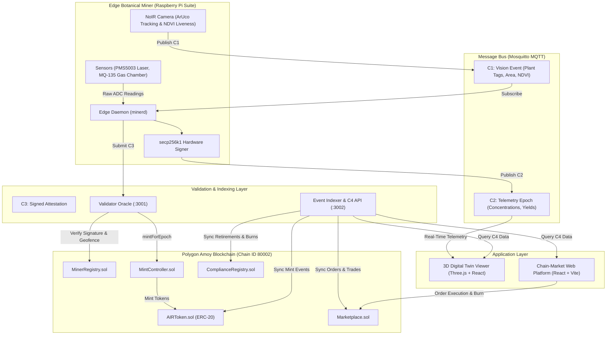

# AIRcoin

> **Proof of Useful Work (PoUW) for Clean Air**  
> An edge IoT botanical miner, an ERC-20 token minted from mathematically verified atmospheric de-pollution, and an institutional compliance marketplace where citizens monetize verified air cleaning and industrial polluters purchase and burn tokens to retire statutory environmental liabilities.

---

## Specification Overview

| Parameter | Specification | Details |
|---|---|---|
| **Consensus Mechanism** | Proof of Useful Work (PoUW) | Replaces arbitrary hashing with verified botanical atmospheric de-pollution |
| **Unit of Minting** | 1.0 AIR | Health damage avoided by removing 1.0 mg PM2.5-equivalent |
| **Blockchain Network** | Polygon Amoy Testnet | Chain ID: `80002` |
| **Token Standard** | ERC-20 (AIR) | 18 Decimals, mint controlled strictly by `MintController.sol` |
| **Settlement Currency** | Test INR (`tINR`) | Mock fiat stablecoin for enterprise offset purchases |
| **Epoch Duration** | 60 Seconds | Real-time edge attestation and validation interval |
| **Protocol Schemas** | C1, C2, C3, C4 | Frozen JSON schemas v1 in [`contracts-schema/`](file:///Users/umashankar/Downloads/AIRcoin/contracts-schema) |
| **Edge Hardware** | Raspberry Pi 4/5 | Laser scatter sensors (PMS5003), Gas (MQ-135), NoIR Camera |

---

## 1. System Overview & Core Proposition

Traditional Proof of Work burns massive amounts of electrical power to solve arbitrary mathematical puzzles with zero real-world value. **AIRcoin redirects computing incentives toward physical atmospheric remediation**:

1. **Botanical Particulate Capture**: Specialized botanical racks with species-specific phytoremediation properties (Snake Plant, Peace Lily, Areca Palm, Tulsi, Neem) capture particulate matter (PM2.5, PM10), nitrogen oxides (NO2), sulfur dioxide (SO2), and volatile organic compounds (VOCs).
2. **Edge Cryptographic Proofs**: Laser scatter sensors and gas chambers capture ambient and intake concentrations in real time. An edge daemon executes a verified leaf-area bio-absorption model, signs the epoch with secp256k1 device keys, and generates immutable cryptographic attestations.
3. **Decentralized Validation**: An oracle validator verifies biometric ArUco plant tags, device hardware signatures, and geographical boundaries before authorizing minting on the Polygon blockchain.
4. **Institutional Compliance Loop**: Obligated industrial polluters purchase AIR tokens on the decentralized marketplace using fiat test currency (`tINR`) and burn them on-chain against statutory environmental quotas.

---

## 2. Mathematical Formulation & Bio-Absorption Model

AIRcoin establishes a deterministic, mathematically verifiable relationship between physical plant biology, sensor measurements, and token minting.

### 2.1 The Bio-Uptake Engine

For each plant slot $i$ and pollutant $p$, the instantaneous pollutant removal rate $R_{i,p}$ ($mg/h$) is computed by the edge daemon:

$$R_{i,p} = k_{s(i), p} \times A_i \times H_i \times f\left(\frac{C_p}{C_{p,\text{ref}}}\right) \times \Delta t$$

Where:
- $k_{s(i), p}$: Species-specific baseline absorption rate ($mg/m^2\cdot h$) for species $s(i)$ and pollutant $p$.
- $A_i$: Effective green leaf surface area ($m^2$) derived from optical computer vision segmentation.
- $H_i$: Biometric plant health factor ($0.0 \le H_i \le 1.0$) determined by NDVI spectral reflectance.
- $C_p$: Measured ambient concentration of pollutant $p$.
- $C_{p,\text{ref}}$: Reference concentration baseline from standard ambient air quality guidelines.
- $f(x)$: Non-linear concentration response curve, capped at $5.0\times$ baseline to prevent artificial sensor saturation attacks.
- $\Delta t$: Epoch duration time interval ($h$).

### 2.2 Damage-Cost Equivalence (PM2.5-Equivalent)

To aggregate disparate pollutants into a single unified token metric, AIRcoin weights each pollutant by its societal health damage cost based on the **CE Delft Environmental Prices Handbook (EU28 central values)**:

$$\text{Weight}(p) = \frac{\text{Damage Cost}(p)}{\text{Damage Cost}(\text{PM2.5})}$$

$$\text{Total AIR Minted} = \sum_{p} \left( \text{Weight}(p) \times \sum_{i=1}^{N} R_{i,p} \right)$$

| Pollutant | Chemical / Symbol | Damage Cost (EUR/kg) | Relative Weight ($w_p$) | Baseline Ref. Conc. |
|---|---|---:|---:|---|
| **PM2.5** | Fine Particulate Matter | EUR 38.70 | **1.000** (Reference) | 35 ug/m3 |
| **PM10** | Coarse Particulate Matter | EUR 26.60 | **0.690** | 50 ug/m3 |
| **NO2** | Nitrogen Dioxide | EUR 14.80 | **0.380** | 25 ppb |
| **SO2** | Sulfur Dioxide | EUR 11.50 | **0.300** | 10 ppb |
| **VOCs** | Volatile Organic Compounds | EUR 1.15 | **0.030** | 100 VOC Index |
| **CO2** | Carbon Dioxide | EUR 0.057 | **0.0015** | 420 ppm |
| **CO** | Carbon Monoxide | EUR 0.0526 | **0.0014** | 1.0 ppm |

### 2.3 Cryptographic Safety Caps
To prevent oracle abuse or runaway minting:
- **Per-Plant Cap**: Maximum $0.01\text{ AIR}$ per plant per epoch ($60\text{ s}$).
- **Per-Miner Cap**: Maximum $0.20\text{ AIR}$ per miner per epoch ($20\text{ plants} \times 0.01$).
- **Single-Mint Guarantee**: `MintController.sol` enforces that each epoch index can only be minted once per registered hardware device.

---

## 3. Multi-Layer Anti-Cheat & Physical Attestation

Physical Proof of Useful Work requires defense against physical and cryptographic spoofing:

1. **Optical ArUco Tag Tracking**: Each plant pot carries a registered waterproof ArUco fiducial marker. The vision pipeline continuously decodes marker IDs and verifies that each tag belongs to the miner's authorized registry set.
2. **Species Re-Identification**: A MobileNetV3 visual embedding model extracts high-dimensional feature vectors of each plant. Swapping an enrolled plant with a different species immediately flags the slot as `suspect`.
3. **NDVI Spectral Liveness Filter**: Using a NoIR camera module with a dual-band blue filter, the pipeline computes the Normalized Difference Vegetation Index:
   $$\text{NDVI} = \frac{\text{NIR} - \text{Red}}{\text{NIR} + \text{Red}}$$
   Live photosynthetic plant tissue reflects strongly in near-infrared while absorbing visible red. Plastic artificial plants, paper photographs, and dead foliage fail this threshold and receive a health score of zero.
4. **Physical Airflow Differential**: Dual optical particulate sensors measure both incoming ambient air and post-canopy filtered exhaust to confirm measurable physical particulate drop.
5. **secp256k1 Device Key Signing**: Each physical miner possesses an onboard secp256k1 private key generated inside hardware security. All telemetry epochs are signed before dispatch. The validator recovers the signer address on-chain via `ecrecover`.

---

## 4. End-to-End System Architecture



---

## 5. Smart Contracts & Polygon Amoy State

All six protocol smart contracts are deployed and verified on the **Polygon Amoy Testnet** (Chain ID `80002`):

| Contract | Polygon Amoy Address | Role & Architecture | Explorer Link |
|---|---|---|---|
| **AIRToken** | `0x7388415fBf7C817CC15b09f03BAaFc05044FB911` | Canonical ERC-20 utility token representing verified atmospheric de-pollution (18 decimals). Mintable exclusively by `MintController.sol`. | [View on Polygonscan](https://amoy.polygonscan.com/address/0x7388415fBf7C817CC15b09f03BAaFc05044FB911) |
| **TestINR** | `0x30Bc6d7f428416bAeC6E00B110cF866AD04Fc2Ab` | ERC-20 mock fiat stablecoin (`tINR`) enabling institutional polluters to purchase AIR tokens on the marketplace. | [View on Polygonscan](https://amoy.polygonscan.com/address/0x30Bc6d7f428416bAeC6E00B110cF866AD04Fc2Ab) |
| **MinerRegistry** | `0x5190eBE58f9061A739c2E53F021cA935B7aac1ec` | Authoritative registry tracking physical miner IDs, device public keys, owner wallets, sticker set hashes, and geofences. | [View on Polygonscan](https://amoy.polygonscan.com/address/0x5190eBE58f9061A739c2E53F021cA935B7aac1ec) |
| **MintController** | `0xaE768B5A97b782C6cb171acd9f24d4d45b5a6557` | Enforces hardware signature verification (`ecrecover`), single-mint-per-epoch rules, calibration hash checks, and rate caps. | [View on Polygonscan](https://amoy.polygonscan.com/address/0xaE768B5A97b782C6cb171acd9f24d4d45b5a6557) |
| **Marketplace** | `0x43FC1D02B74772f47f7645be819eD7b96A889d79` | Non-custodial order book enabling citizens to list earned AIR tokens and enterprises to execute atomic settlement in `tINR`. | [View on Polygonscan](https://amoy.polygonscan.com/address/0x43FC1D02B74772f47f7645be819eD7b96A889d79) |
| **ComplianceRegistry** | `0x04b55e1dD7aF920d016e9aDb5c01Ee457E9E3831` | Regulatory registry where government authorities mandate corporate offset quotas and enterprises permanently burn tokens to retire liabilities. | [View on Polygonscan](https://amoy.polygonscan.com/address/0x04b55e1dD7aF920d016e9aDb5c01Ee457E9E3831) |

Live contract deployment metadata is stored in [`chain-market/contracts/deployments.json`](file:///Users/umashankar/Downloads/AIRcoin/chain-market/contracts/deployments.json).

---

## 6. Interface Schemas (C1–C4 Protocol)

All inter-service messaging conforms to immutable, versioned contracts defined in [`contracts-schema/`](file:///Users/umashankar/Downloads/AIRcoin/contracts-schema):

- **C1: Vision Event (`c1-vision-event.json`)**: Emitted by the optical camera rig at 1 Hz. Identifies detected ArUco tag IDs, matched plant species, computed leaf surface area ($cm^2$), and NDVI liveness scores across all 20 rack slots.
- **C2: Telemetry Epoch (`c2-epoch.json`)**: Broadcast by the miner daemon every 60 seconds over MQTT. Contains ambient concentration averages (PM2.5, PM10, CO2, VOC, NO2, SO2, CO), intake telemetry, individual plant absorption yields, cumulative AIR totals, and attestation readiness.
- **C3: Signed Attestation (`c3-attestation.json`)**: Dispatched by the miner daemon to the Validator Oracle. Encapsulates epoch indexes, claimed token quantities, evidence hashes, and the secp256k1 ECDSA hardware signature.
- **C4: Indexer & Query API (`c4-*.json`)**: Public REST and WebSocket interfaces served by the event indexer for frontend visualization, historic epoch queries, compliance verification, and order book matching.

---

## 7. Phytoremediation Botanical Catalogue

AIRcoin integrates botanical species tested in the **NASA Clean Air Study (Wolverton et al., 1989)** and urban phytoremediation field literature:

| Species Common Name | Scientific Name | Placement | Primary Target Pollutants | Uptake Profile | Scientific Citation |
|---|---|---|---|---|---|
| **Snake Plant** | *Dracaena trifasciata* | Indoor | Benzene, Formaldehyde, TCE, Xylene, Night CO2 | High VOC, Night CO2 | NASA Clean Air Study |
| **Peace Lily** | *Spathiphyllum wallisii* | Indoor | Benzene, Formaldehyde, Ammonia, Trichloroethylene | High VOC, High Transpiration | NASA Clean Air Study |
| **Areca Palm** | *Dypsis lutescens* | Indoor | PM2.5, Formaldehyde, Xylene, Toluene | High Transpiration, Medium PM | Wolverton Environmental |
| **Tulsi (Holy Basil)** | *Ocimum tenuiflorum* | Outdoor / Balcony | Sulfur Dioxide (SO2), Nitrogen Oxides (NOx), PM10 | High SO2, Medium NOx | Urban Phytoremediation Studies |
| **Neem** | *Azadirachta indica* | Outdoor / Balcony | Heavy Particulates (PM2.5/PM10), SO2, Exhaust Aerosols | High PM Deposition Velocity | Central Pollution Control Board |

Full species definitions, base rates, and calibration curves are codified in [`contracts-schema/data/species-catalogue.json`](file:///Users/umashankar/Downloads/AIRcoin/contracts-schema/data/species-catalogue.json).

---

## 8. Monorepo Workstreams & Repository Layout

This repository is organized into distinct workstreams communicating exclusively through versioned contracts:

```
AIRcoin/
├── contracts-schema/         # Shared frozen JSON schemas (C1-C4), species catalogue, and validation scripts
│   ├── data/                 # species-catalogue.json, reference concentrations, damage cost tables
│   ├── schemas/              # JSON Schema validation definitions for C1, C2, C3, and C4 interfaces
│   └── scripts/              # Automated protocol schema validation tools
│
├── vision-twin/              # Workstream A: Vision pipeline and 3D digital twin
│   ├── pipeline/             # Python ArUco detection, MobileNetV3 classifier, NDVI spectral analysis
│   └── twin/                 # Interactive Three.js 3D living miner viewer, exploded hardware model, HUD
│
├── miner-core/               # Workstream B: Edge miner daemon and PoUW engine
│   ├── minerd/               # Edge daemon, sensor drivers, SQLite offline queue, secp256k1 signer
│   ├── simulation/           # Multi-scenario atmospheric simulator (Clean Morning, Rush Hour, Smog)
│   └── tests/                # Automated pytest suites for bio-uptake mathematics and anti-cheat
│
├── chain-market/             # Workstream C: Blockchain contracts, oracle, and web platform
│   ├── contracts/            # Hardhat Solidity smart contracts (AIRToken, Marketplace, Compliance)
│   ├── validator/            # Node.js attestation oracle, signature verification, on-chain submitter
│   ├── indexer/              # Real-time event indexer, SQLite datastore, C4 REST and WebSocket server
│   └── web/                  # Web platform (Citizen Wallet, Marketplace, Corporate Burn, Regulator)
│
├── infra/                    # Architecture runbooks, Docker Compose configs, and NGINX gateway definitions
└── scripts/                  # Unified local orchestration and test execution scripts
```

---

## 9. Interactive Local Demo & Quickstart

The entire AIRcoin stack can be launched locally with a single script. The runner manages background microservices, sets up local blockchain nodes, initializes the MQTT broker, and spins up both frontend interfaces.

### Quickstart

#### On macOS & Linux:
```bash
./scripts/demo.sh start
```

#### On Windows:
```bat
scripts\demo.cmd start
```

### Management Commands
```bash
./scripts/demo.sh status   # Check health of running background microservices
./scripts/demo.sh stop     # Gracefully terminate all local services
```

### Local Services & Ports

| Service | Port | Local URL | Role |
|---|---:|---|---|
| **3D Digital Twin** | 5174 | `http://localhost:5174` | Three.js living miner model, 20-slot botanical rack, exploded hardware inspector, and plant health monitor |
| **Chain-Market Platform** | 5173 | `http://localhost:5173` | Citizen Wallet, Credit Marketplace, Corporate Burn Portal, and Government Oversight console |
| **Scenario Controller** | 8090 | `http://localhost:8090` | Interactive pollution scenario simulator (Clean Morning, Rush Hour, Festival Smog) |
| **Service Health Check** | 8090 | `http://localhost:8090/health` | Real-time connectivity monitor for Miner, MQTT, Validator, and Blockchain |
| **Validator Oracle** | 3001 | `http://localhost:3001` | Attestation signature verification service and mint submission pipeline |
| **Event Indexer** | 3002 | `http://localhost:3002` | Real-time C4 query API and WebSocket event feed |
| **Local EVM Node** | 8545 | `http://localhost:8545` | Hardhat Ethereum development network |
| **Mosquitto MQTT** | 1883 | `mqtt://localhost:1883` | IoT message broker (WebSocket bridge on `:9001`) |

---

## 10. Guided Feature Walkthrough

### 1. Verify Connectivity
Navigate to `http://localhost:8090/health`. Confirm that all four diagnostic indicators (Miner Daemon, Mosquitto MQTT, Validator Oracle, Blockchain Node) display healthy green states.

### 2. Simulate Atmospheric Scenarios
Open the Scenario Controller at `http://localhost:8090/`:
- **Clean Morning (AQI ~45)**: Baseline ambient conditions; moderate baseline token accumulation.
- **Rush Hour (AQI ~180)**: Elevated nitrogen dioxide and particulate concentrations; increased bio-absorption rate.
- **Festival Smog (AQI ~400)**: Severe atmospheric pollution; bio-uptake engine reaches peak operational capacity.

### 3. Explore the 3D Living Miner Digital Twin
Open `http://localhost:5174`:
- **Orbit Controls**: Left-click to rotate, right-click to pan, scroll to zoom around the 20-slot living botanical array.
- **Hardware Exploded View**: Hover over the central sensor housing to trigger the HUD hint, then click to animate the exploded inspection view of the internal PMS5003 laser sensor, MQ-135 chamber, Raspberry Pi controller, and power bus.
- **Optical & NDVI Vision**: Toggle between real-time RGB optical monitoring and false-color NDVI plant vigor maps in the camera PiP display.
- **Anti-Cheat Verification**: Drag botanical pots to simulate tampering and observe immediate anti-cheat invalidation in the telemetry HUD.

### 4. Trade and Retire Credits on the Marketplace
Open `http://localhost:5173`:
- **Citizen Account (Alice)**: Review verified AIR token balances minted from miner `miner-001`. Create a sell listing on the decentralized exchange.
- **Corporate Account (Apex Steel Works)**: View statutory carbon offset quotas for the 2026 fiscal year. Purchase available AIR credits using `tINR` liquidity.
- **Retirement / Burn Portal**: Execute an on-chain compliance burn. The smart contract burns tokens irreversibly and registers the reduction in `ComplianceRegistry.sol`.
- **Regulator Console**: Access government auditing views to inspect rejected attestation logs, miner geofence boundaries, and network-wide de-pollution statistics.

---

## 11. Test Suites & Verification

Verify system guarantees and mathematical invariant correctness locally:

```bash
# 1. Interface Schemas & Species Catalogue Validation
python3 contracts-schema/scripts/validate.py

# 2. Smart Contract Unit Tests (Hardhat)
cd chain-market/contracts && npx hardhat test

# 3. Indexer Store & Deduplication Tests
cd chain-market/indexer && npm test

# 4. Miner Estimation Engine, Cryptography & Anti-Cheat Unit Tests (Pytest)
cd miner-core && pytest -q tests/

# 5. Client Application Production Bundle Verification
cd vision-twin/twin && npm run build
cd ../../chain-market/web && npm run build
```

---

## 12. Technical Specifications & References

- **Botanical Calibration Protocol**: [`miner-core/docs/calibration-protocol.md`](file:///Users/umashankar/Downloads/AIRcoin/miner-core/docs/calibration-protocol.md) — Mathematical formulations for particulate deposition velocity, aerodynamic resistance, and leaf area indexing.
- **Workstream Handoff Specifications**: [`miner-core/docs/handoff-vision-twin.md`](file:///Users/umashankar/Downloads/AIRcoin/miner-core/docs/handoff-vision-twin.md) — Contract-driven interfaces between edge computer vision and the living digital twin.
- **Frozen Protocol Schemas**: [`contracts-schema/README.md`](file:///Users/umashankar/Downloads/AIRcoin/contracts-schema/README.md) — Specification for C1, C2, C3, and C4 data schemas.
- **Smart Contract Architecture**: [`chain-market/README.md`](file:///Users/umashankar/Downloads/AIRcoin/chain-market/README.md) — On-chain security rules, role permissions, and tokenomics.
