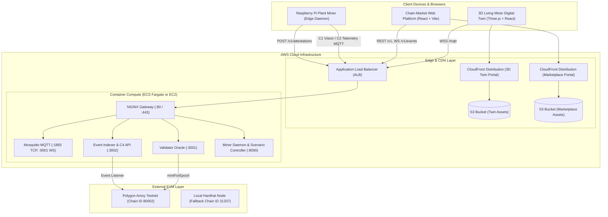

# AIRcoin AWS Production Deployment Guide

This operations guide details the deployment procedures for the AIRcoin platform on Amazon Web Services (AWS), from container orchestration and smart contracts on Polygon Amoy to static frontend CDN delivery, SSL termination, and health monitoring.

---

## 1. System Architecture Overview



---

## 2. Deployment Architecture Comparison

| Dimension | Option 1: Fast EC2 + Docker Compose | Option 2: Enterprise ECS Fargate + CloudFront | Option 3: Hybrid (AWS Backend + Vercel Frontends) |
|---|---|---|---|
| **Target Use Case** | Hackathon judging, staging, single-node demos | Production enterprise, high availability, scaling | Modern cloud-native setup (AWS API + Vercel Edge UI) |
| **Estimated Cost** | ~$15 - $30 / month (`t3.medium`) | Pay-as-you-go per vCPU/RAM hour + CDN data transfer | Free Vercel hobby/pro tier + ~$15 - $30 / month AWS |
| **Setup Time** | 5 - 10 minutes | 20 - 30 minutes | 10 - 15 minutes |
| **Frontend Delivery** | NGINX container reverse proxy | S3 + CloudFront CDN with Origin Access Control (OAC) | Vercel Edge Network with instant global distribution |
| **Container Engine** | Docker Compose on EC2 host | AWS ECS Fargate serverless containers | Docker on EC2 or ECS Fargate (backend only) |
| **SSL / TLS** | Automated Let's Encrypt Certbot on NGINX | AWS Certificate Manager (ACM) attached to ALB/CloudFront | Automated Vercel SSL for UI + Let's Encrypt / ACM for API |
| **Guide & IaC** | `infra/aws/ec2-setup.sh` | CloudFormation / Terraform (`infra/aws/`) | [`infra/VERCEL-DEPLOYMENT-GUIDE.md`](VERCEL-DEPLOYMENT-GUIDE.md) |

---

## 3. Prerequisites and Tooling Setup

Install and configure required CLI tools on your deployment workstation:

1. **AWS CLI v2**:
   ```bash
   aws configure
   # Set AWS Access Key ID, Secret Access Key, and Default Region (e.g. ap-south-1)
   ```
2. **Docker & Buildx**:
   ```bash
   docker --version
   docker buildx version
   ```
3. **Node.js (v18+) & Python (v3.10+)**:
   ```bash
   node --version
   python3 --version
   ```
4. **Polygon Amoy Gas POL**:
   Ensure your deployer private key has testnet POL from the [Polygon Faucet](https://faucet.polygon.technology/).

---

## 4. Option 1: Fast Single-Instance AWS EC2 Deployment

### Step 1: Launch EC2 Instance
- **AMI**: Amazon Linux 2023 or Ubuntu 22.04 LTS (x86_64 or arm64)
- **Instance Type**: `t3.medium` (2 vCPU, 4 GiB RAM)
- **Storage**: 20 GiB gp3 SSD
- **Security Group Inbound Rules**:
  - `22`: SSH (restrict to administrator CIDR)
  - `80`: HTTP (0.0.0.0/0)
  - `443`: HTTPS (0.0.0.0/0)
  - `1883`: MQTT TCP (optional, for direct Raspberry Pi connections)
  - `9001`: MQTT WebSockets (optional)

### Step 2: Automated Bootstrap via User Data
In the EC2 launch console under **Advanced Details**, paste the contents of [`infra/aws/ec2-setup.sh`](aws/ec2-setup.sh) into the **User Data** field.

Alternatively, connect via SSH and execute manually:
```bash
sudo git clone https://github.com/prabhu-omkar/AIRcoin.git /opt/aircoin
cd /opt/aircoin
sudo bash infra/aws/ec2-setup.sh
```

### Step 3: Configure Environment Variables
Edit `/opt/aircoin/.env`:
```ini
RPC_URL=https://rpc-amoy.polygon.technology
CHAIN_ID=80002
ADMIN_KEY=0xYourValidatorPrivateKey
DEPLOYER_PRIVATE_KEY=0xYourDeployerPrivateKey
PORT_VALIDATOR=3001
PORT_INDEXER=3002
PORT_MINER=8090
PORT_CHAIN_WEB=5173
PORT_TWIN_WEB=5174
```

### Step 4: Configure Domain and SSL (Optional)
To obtain an automated SSL certificate with Let's Encrypt Certbot:
```bash
sudo dnf install -y certbot || sudo apt-get install -y certbot
sudo certbot certonly --standalone -d yourdomain.com -d www.yourdomain.com
```
Update [`infra/aws/nginx.conf`](aws/nginx.conf) to point to `/etc/letsencrypt/live/yourdomain.com/fullchain.pem` and restart containers:
```bash
sudo docker compose -f docker-compose.prod.yml restart nginx-gateway
```

### Step 5: Verify Deployment
```bash
curl http://localhost/healthz
curl http://localhost/health
```

---

## 5. Option 2: Enterprise High-Availability (ECS Fargate + S3 + CloudFront)

### Step 1: Deploy Smart Contracts to Polygon Amoy
Run the automated deployment script:
```bash
export DEPLOYER_PRIVATE_KEY="0xYourDeployerPrivateKey"
export AMOY_RPC_URL="https://rpc-amoy.polygon.technology"

bash infra/aws/deploy-contracts-amoy.sh
```
This compiles the Solidity contracts, deploys them to Polygon Amoy, runs initial seed operations, and writes addresses to `chain-market/contracts/deployments.json`.

### Step 2: Build and Push Container Images to Amazon ECR
```bash
AWS_REGION=ap-south-1
ACCOUNT_ID=$(aws sts get-caller-identity --query Account --output text)
ECR_BASE="${ACCOUNT_ID}.dkr.ecr.${AWS_REGION}.amazonaws.com"

# Log in to ECR
aws ecr get-login-password --region ${AWS_REGION} | docker login --username AWS --password-stdin ${ECR_BASE}

# 1. Validator Oracle
aws ecr create-repository --repository-name aircoin/validator --region ${AWS_REGION} || true
docker build -t ${ECR_BASE}/aircoin/validator:latest -f chain-market/validator/Dockerfile chain-market/validator
docker push ${ECR_BASE}/aircoin/validator:latest

# 2. Event Indexer
aws ecr create-repository --repository-name aircoin/indexer --region ${AWS_REGION} || true
docker build -t ${ECR_BASE}/aircoin/indexer:latest -f chain-market/indexer/Dockerfile chain-market/indexer
docker push ${ECR_BASE}/aircoin/indexer:latest

# 3. Miner Core Daemon
aws ecr create-repository --repository-name aircoin/miner --region ${AWS_REGION} || true
docker build -t ${ECR_BASE}/aircoin/miner:latest -f miner-core/Dockerfile miner-core
docker push ${ECR_BASE}/aircoin/miner:latest
```

### Step 3: Deploy Backend Infrastructure

#### Using AWS CloudFormation:
```bash
aws cloudformation create-stack \
  --stack-name aircoin-prod-ecs \
  --template-body file://infra/aws/cloudformation/aircoin-ecs-fargate.yml \
  --capabilities CAPABILITY_NAMED_IAM \
  --parameters \
    ParameterKey=EnvironmentName,ParameterValue=aircoin-prod \
    ParameterKey=RpcUrl,ParameterValue=https://rpc-amoy.polygon.technology \
    ParameterKey=AdminPrivateKey,ParameterValue="0xYourValidatorPrivateKey" \
    ParameterKey=ValidatorImage,ParameterValue="${ECR_BASE}/aircoin/validator:latest" \
    ParameterKey=MinerImage,ParameterValue="${ECR_BASE}/aircoin/miner:latest"
```

#### Or Using HashiCorp Terraform:
```bash
cd infra/aws/terraform
terraform init
terraform plan \
  -var="aws_region=${AWS_REGION}" \
  -var="environment=aircoin-prod" \
  -var="validator_image=${ECR_BASE}/aircoin/validator:latest" \
  -var="miner_image=${ECR_BASE}/aircoin/miner:latest" \
  -var="admin_private_key=0xYourValidatorPrivateKey" \
  -out=tfplan

terraform apply tfplan
```

### Step 4: Deploy Static Frontends to S3 and CloudFront
Deploy CloudFormation stacks to create private S3 buckets and CloudFront distributions:
```bash
# Chain-Market Web Portal
aws cloudformation create-stack \
  --stack-name aircoin-market-frontend \
  --template-body file://infra/aws/cloudformation/aircoin-s3-cloudfront.yml \
  --parameters ParameterKey=ProjectName,ParameterValue=aircoin-market

# 3D Living Miner Digital Twin
aws cloudformation create-stack \
  --stack-name aircoin-twin-frontend \
  --template-body file://infra/aws/cloudformation/aircoin-s3-cloudfront.yml \
  --parameters ParameterKey=ProjectName,ParameterValue=aircoin-twin

aws cloudformation wait stack-create-complete --stack-name aircoin-market-frontend
aws cloudformation wait stack-create-complete --stack-name aircoin-twin-frontend
```

Retrieve bucket names and distribution IDs:
```bash
export MARKET_BUCKET=$(aws cloudformation describe-stacks --stack-name aircoin-market-frontend --query "Stacks[0].Outputs[?OutputKey=='BucketName'].OutputValue" --output text)
export MARKET_CF_DIST=$(aws cloudformation describe-stacks --stack-name aircoin-market-frontend --query "Stacks[0].Outputs[?OutputKey=='DistributionId'].OutputValue" --output text)

export TWIN_BUCKET=$(aws cloudformation describe-stacks --stack-name aircoin-twin-frontend --query "Stacks[0].Outputs[?OutputKey=='BucketName'].OutputValue" --output text)
export TWIN_CF_DIST=$(aws cloudformation describe-stacks --stack-name aircoin-twin-frontend --query "Stacks[0].Outputs[?OutputKey=='DistributionId'].OutputValue" --output text)
```

Run the automated build, sync, and cache invalidation script:
```bash
bash infra/aws/deploy-s3-frontends.sh
```

---

## 6. Pre-Deployment Local Validation

Always verify test suites across all workstreams before triggering a cloud release:

```bash
# 1. Interface Schemas & Species Catalogue
python contracts-schema/scripts/validate.py

# 2. Smart Contracts (23 passing tests on mint, burn, marketplace, compliance)
cd chain-market/contracts && npx hardhat test

# 3. Event Indexer & Durable C4 Store
cd ../indexer && npm test

# 4. Miner PoUW Engine, Estimation & Signatures (44 passing tests)
cd ../../miner-core && pytest -q

# 5. Frontend Production Bundle Validations
cd ../vision-twin/twin && npm run build
cd ../../chain-market/web && npm run build
```

---

## 7. Health Checks, Smoke Tests and Monitoring

### Public HTTP Endpoints
- **Service Status Dashboard**: `GET /health` (HTML dashboard)
- **Status API**: `GET /api/status` (JSON machine-readable state)
- **ALB Liveness Probe**: `GET /healthz` (returns HTTP 200 `healthy`)
- **Validator Oracle Status**: `GET /health` on port 3001
- **Accepted Proof History**: `GET /v1/accepted`
- **Rejection Log**: `GET /v1/rejections`
- **Miner Token Balance**: `GET /v1/miners/miner-001/balance`

### CloudWatch Metric Alarms
Configure alarms in the AWS CloudWatch console or via Terraform:
1. **ALB 5XX Errors**: Metric `HTTPCode_Target_5XX_Count` > 5 within 60 seconds.
2. **ECS Unhealthy Hosts**: Metric `UnHealthyHostCount` > 0 within 2 evaluation periods.
3. **Queue Attestation Backlog**: Alert if `queued_attestations` in `/api/status` exceeds 10 for > 3 minutes.
4. **Memory Utilization**: Metric `MemoryUtilization` > 85% on ECS tasks.

### Zero Downtime Rolling Updates
To update backend services in ECS without downtime:
```bash
# Force new deployment with updated container image
aws ecs update-service \
  --cluster aircoin-prod-cluster \
  --service aircoin-prod-validator \
  --force-new-deployment

aws ecs update-service \
  --cluster aircoin-prod-cluster \
  --service aircoin-prod-miner \
  --force-new-deployment
```
