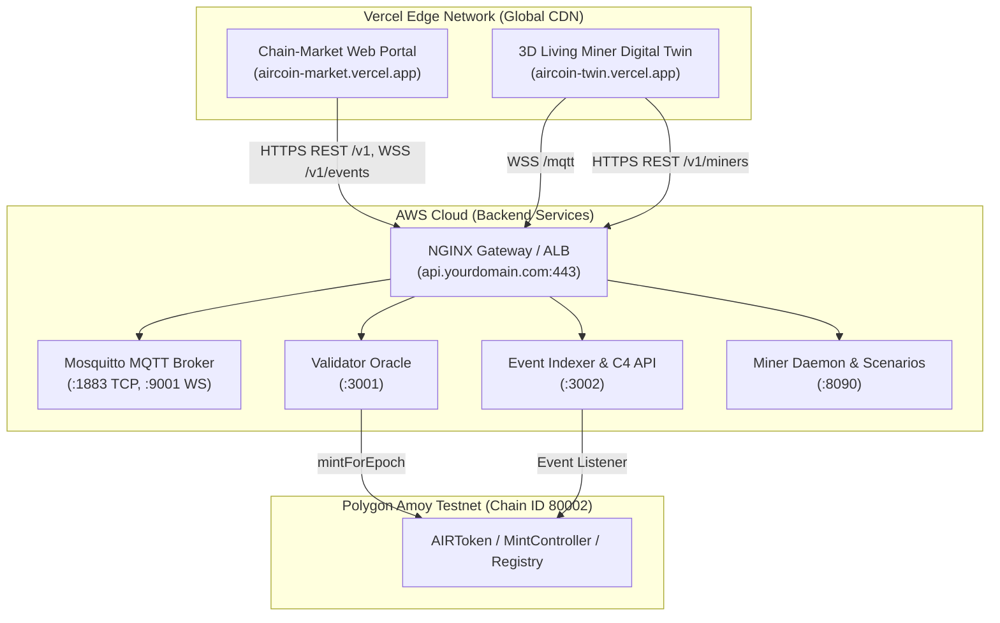

# AIRcoin Vercel Frontend Deployment Guide

This guide details the procedure for deploying both AIRcoin frontends to Vercel while running the backend services (Validator Oracle, Event Indexer, Miner Daemon, and Mosquitto MQTT broker) on Amazon Web Services (AWS) and smart contracts on Polygon Amoy.

---

## 1. Hybrid Architecture Overview



---

## 2. Prerequisites

1. **Active AWS Backend**: Your AWS EC2 or ECS Fargate backend must be running with a public IP or custom domain (e.g. `https://api.yourdomain.com`).
2. **Vercel Account**: Sign up at [vercel.com](https://vercel.com) if you do not already have an account.
3. **Vercel CLI (Optional)**: Install globally or run via `npx`:
   ```bash
   npm install -g vercel
   # or use npx vercel
   ```

---

## 3. Project 1: Chain-Market Web Portal (`chain-market/web`)

The Chain-Market Web Portal is a React and Vite Single Page Application containing the Citizen Wallet, Token Marketplace, Corporate Burn Portal, and Government Admin Portal.

### Method A: Deploy via Vercel Web Dashboard (Recommended)

1. Open the [Vercel Dashboard](https://vercel.com/dashboard) and click **Add New... -> Project**.
2. Import your AIRcoin GitHub repository.
3. Configure Project Settings:
   - **Project Name**: `aircoin-market`
   - **Framework Preset**: `Vite`
   - **Root Directory**: Click *Edit* and select `chain-market/web`
   - **Build Command**: `npm run build`
   - **Output Directory**: `dist`
   - **Install Command**: `npm install`
4. Expand **Environment Variables** and add:
   | Key | Example Value | Description |
   |---|---|---|
   | `VITE_API_URL` | `https://api.yourdomain.com` | Base URL of your AWS NGINX / ALB gateway |
   | `VITE_INDEXER_URL` | `https://api.yourdomain.com` | Indexer endpoint (defaults to VITE_API_URL) |
   | `VITE_VALIDATOR_URL` | `https://api.yourdomain.com` | Validator endpoint (defaults to VITE_API_URL) |
   | `VITE_TWIN_URL` | `https://aircoin-twin.vercel.app` | URL to the deployed 3D Digital Twin |
5. Click **Deploy**.

### Method B: Deploy via Vercel CLI

```bash
cd chain-market/web

# First-time linking and preview deploy:
npx vercel

# Production deploy:
npx vercel --prod
```

When prompted by the CLI:
- Link to existing project? `No` (or select existing)
- Project name? `aircoin-market`
- In which directory is your code located? `./`
- Want to modify settings? `No`

---

## 4. Project 2: 3D Living Miner Digital Twin (`vision-twin/twin`)

The 3D Living Miner Digital Twin is an interactive Three.js and React Three Fiber application featuring the 20-slot botanical rack, exploded IP65 enclosure view with click-to-explode interaction, camera PiP (Lens/NDVI), and Owner Dashboard.

### Method A: Deploy via Vercel Web Dashboard (Recommended)

1. Open the [Vercel Dashboard](https://vercel.com/dashboard) and click **Add New... -> Project**.
2. Select the same AIRcoin repository to create a second project.
3. Configure Project Settings:
   - **Project Name**: `aircoin-twin`
   - **Framework Preset**: `Vite`
   - **Root Directory**: Click *Edit* and select `vision-twin/twin`
   - **Build Command**: `npm run build`
   - **Output Directory**: `dist`
   - **Install Command**: `npm install`
4. Expand **Environment Variables** and add:
   | Key | Example Value | Description |
   |---|---|---|
   | `VITE_MINER_ID` | `miner-001` | Registered miner identifier |
   | `VITE_MQTT_WS` | `wss://api.yourdomain.com/mqtt` | Secure WebSocket URL for Mosquitto on AWS |
   | `VITE_C4_URL` | `https://api.yourdomain.com` | Indexer C4 REST base URL |
   | `VITE_API_URL` | `https://api.yourdomain.com` | API base URL |
   | `VITE_MARKET_URL` | `https://aircoin-market.vercel.app` | URL to the Chain-Market portal |
   | `VITE_MINER_MODEL_URL`| `/models/aircoin-miner.glb` | 3D model asset path |
5. Click **Deploy**.

### Method B: Deploy via Vercel CLI

```bash
cd vision-twin/twin

# Production deploy:
npx vercel --prod
```

---

## 5. One-Command Automated Vercel Deployment

You can build and deploy both frontends to Vercel in a single command using the provided script:

```bash
# Preview deployment:
./scripts/deploy-vercel.sh

# Production deployment:
./scripts/deploy-vercel.sh --prod
```

---

## 6. Configuring CORS & WebSockets on the AWS Backend

### 1. Cross-Origin Resource Sharing (CORS)
When the frontends run on `*.vercel.app`, the browser will make cross-origin requests to your AWS API domain:
- `chain-market/validator`: Enabled via Express `cors()` middleware.
- `chain-market/indexer`: Enabled via Express `cors()` middleware.
- `miner-core`: Enabled via FastAPI `CORSMiddleware` (`allow_origins=["*"]`).
- `infra/aws/nginx.conf`: NGINX automatically passes upstream CORS headers through to client responses.

### 2. Secure WebSockets (WSS) for MQTT
Modern browsers require secure WebSockets (`wss://`) when the web application is loaded over HTTPS (as provided by Vercel):
- Configure an SSL certificate on your AWS NGINX gateway using Let's Encrypt Certbot:
  ```bash
  sudo certbot certonly --standalone -d api.yourdomain.com
  ```
- NGINX proxies `location /mqtt` with `Upgrade: websocket` to Mosquitto on internal port `:9001`.
- Set `VITE_MQTT_WS=wss://api.yourdomain.com/mqtt` in the `aircoin-twin` Vercel environment variables.

---

## 7. Custom Domains & DNS Routing

For a unified production setup:
- `market.aircoin.eco` -> Points to Vercel (`cname.vercel-dns.com`)
- `twin.aircoin.eco` -> Points to Vercel (`cname.vercel-dns.com`)
- `api.aircoin.eco` -> Points to AWS Elastic IP or Application Load Balancer
